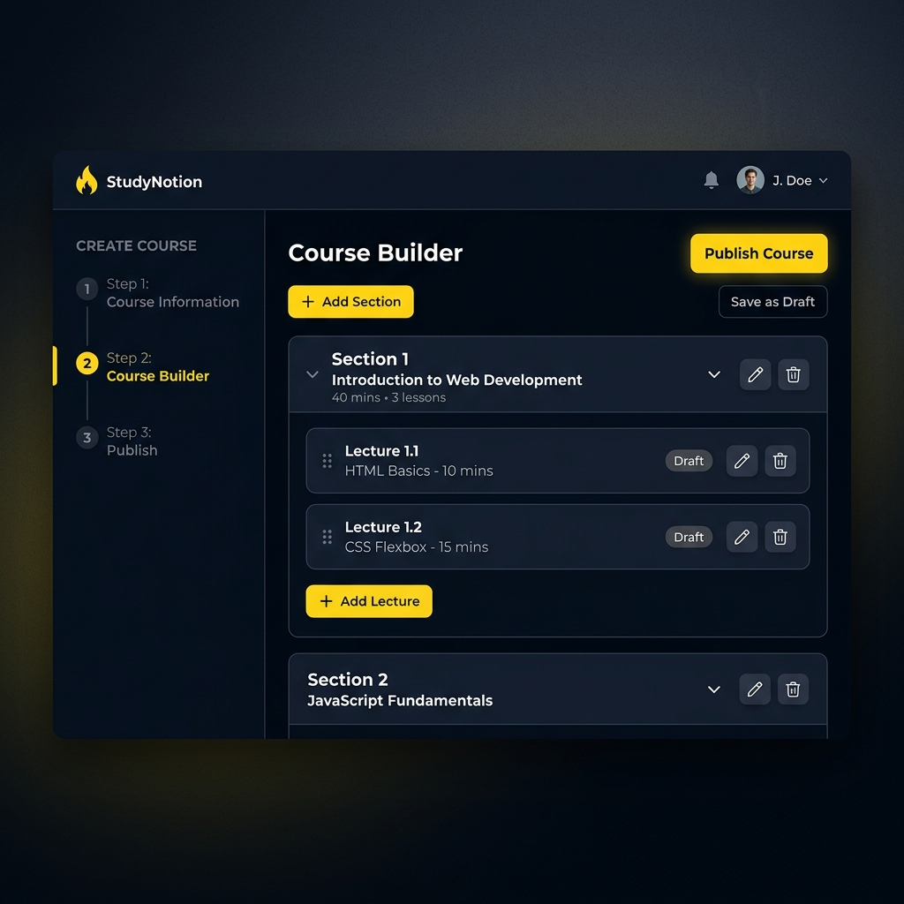
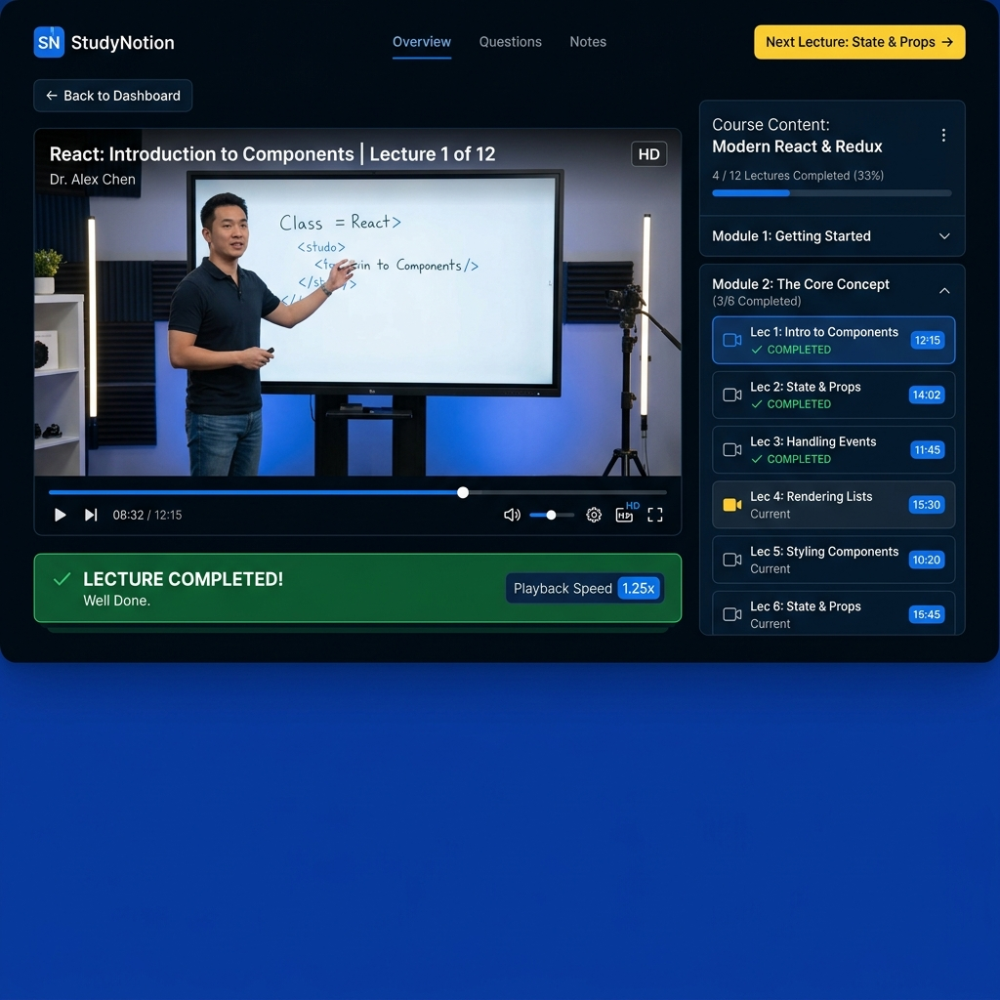
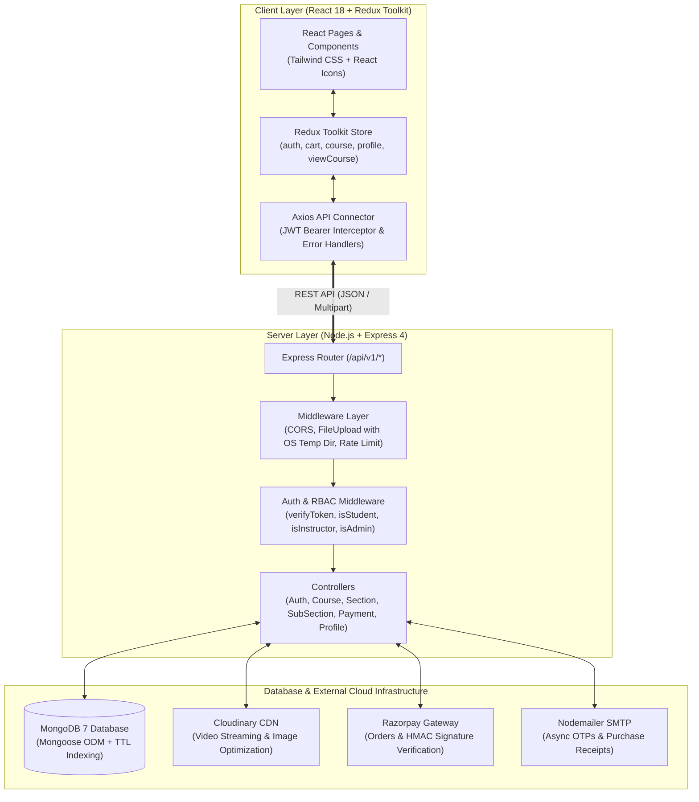
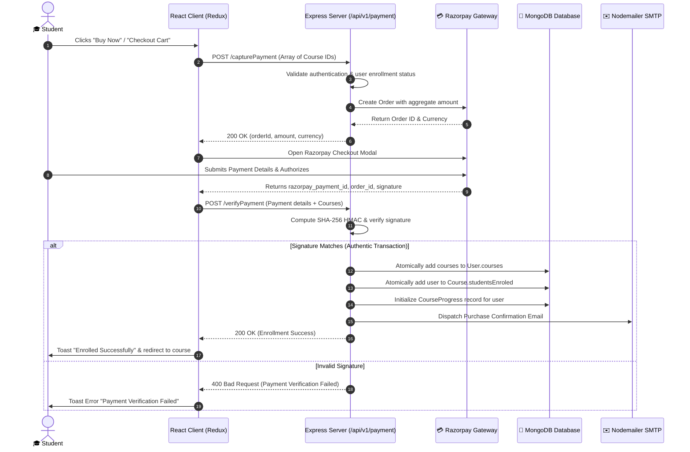
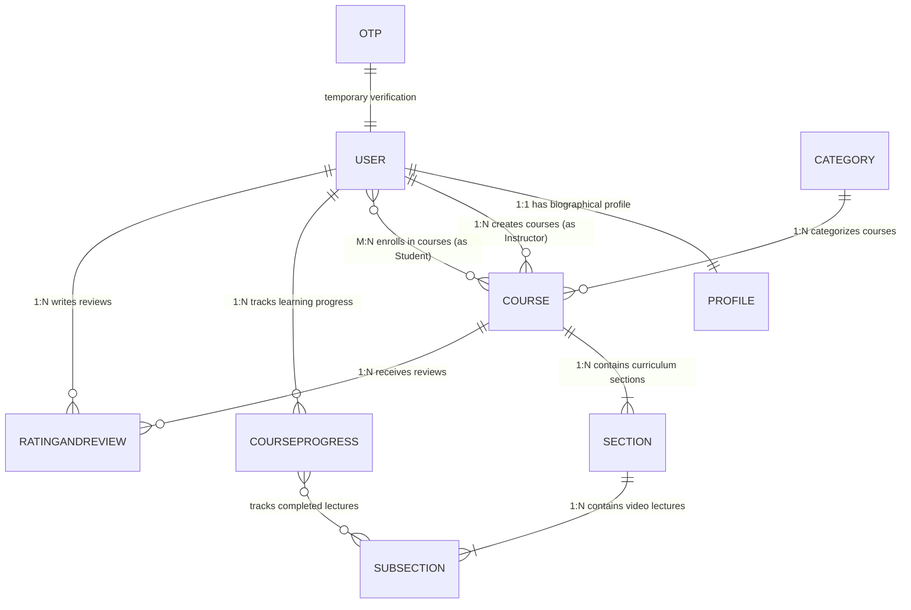

<div align="center">
  
  <h1>StudyNotion — Enterprise EdTech & E-Learning Platform</h1>
  <p><b>A modern, production-grade MERN stack learning management system bridging students and educators with real-time video streaming, multi-tier curriculum authoring, Razorpay checkout, and granular role-based access control.</b></p>

  <p>
    <a href="https://reactjs.org/"></a>
    <a href="https://redux-toolkit.js.org/"></a>
    <a href="https://tailwindcss.com/"></a>
    <a href="https://nodejs.org/"></a>
    <a href="https://www.mongodb.com/"></a>
    <a href="https://cloudinary.com/"></a>
    <a href="https://razorpay.com/"></a>
  </p>

  <p>
    <a href="#-project-overview">Overview</a> •
    <a href="#-platform-showcase--visual-previews">UI Showcase</a> •
    <a href="#-user-roles--feature-matrix">Features</a> •
    <a href="#-system-architecture--data-flows">Architecture</a> •
    <a href="#-tech-stack-matrix">Tech Stack</a> •
    <a href="#-database-schemas--entity-relationships">Data Models</a> •
    <a href="#-key-engineering-challenges--interview-talking-points">Interview Highlights</a> •
    <a href="#-api-specification">API Reference</a> •
    <a href="#-local-development-setup">Setup Guide</a>
  </p>
</div>

---

## 💡 Project Overview

**StudyNotion** is a full-featured, scalable Educational Technology (EdTech) platform designed to deliver an interactive, friction-free learning environment for students and a powerful content management system for instructors. 

### Why StudyNotion?
* **For Learners:** Eliminates fragmented learning experiences by bundling course discovery, preview catalogs, secure multi-item cart checkouts via Razorpay, instant video streaming, and persistent progress tracking in one unified interface.
* **For Educators:** Offers a modular 3-step authoring studio where creators can structure curriculums hierarchically (Course ➔ Sections ➔ Lectures), upload video media directly to Cloudinary with automatic duration parsing, and monitor revenue and enrollment analytics.
* **For Administrators:** Provides category curation and platform governance to maintain a high-quality public catalog.

---

## 📸 Platform Showcase & Visual Previews

### 1. Student Landing & Exploration Hub
The public landing page features a sleek dark-mode aesthetic with ambient glow effects, live interactive code preview blocks with syntax highlighting, course category filters, and authentic peer testimonials.

<div align="center">
  
</div>

<br/>

> **Key Capabilities Displayed:**
> - **Dynamic Hero Banner:** Dual CTA pathways for learners (`Learn More`) and instructors (`Become an Instructor`).
> - **Interactive Code Blocks:** Embedded coding playground simulation with customizable syntax themes and type animations.
> - **Categorized Course Discovery:** Instant tabbed switching between Free, Web Development, and Career Tracks.
> - **Social Proof & Stats:** Real-time platform metrics (10+ Years Experience, 250+ Courses, 100+ Best Instructors).

---

### 2. Multi-Tier Curriculum Builder (Instructor Studio)
A modular 3-step course authoring wizard designed to guide educators from draft creation to public launch without cognitive overload.

<div align="center">
  
</div>

<br/>

> **Authoring Workflow:**
> 1. **Step 1: Course Information:** Metadata, pricing, category classification, requirements, and Cloudinary thumbnail image upload.
> 2. **Step 2: Course Builder:** Interactive tree-based curriculum editor. Instructors create sections, nest lectures (subsections), upload video lectures with auto-calculated duration, and arrange modules with full editing and deletion controls.
> 3. **Step 3: Publish Settings:** Toggle course visibility between `Draft` (private staging) and `Published` (live in public catalog).

---

### 3. Interactive Video Player & Learning Progress Dashboard
The enrolled student classroom provides an immersive streaming experience with collapsible curriculum navigation and real-time progress persistence.

<div align="center">
  
</div>

<br/>

> **Player Highlights:**
> - **Curriculum Drawer:** Collapsible sidebar displaying all sections and lectures with individual durations and live completion checkmarks.
> - **Dynamic Progress Calculation:** Real-time percentage indicator computed on the server based on completed lectures.
> - **Interactive Actions:** One-click lecture completion toggles, review rating modal, and seamless sequential playback navigation.

---

## 👥 User Roles & Feature Matrix

| Feature Domain | 🎓 Student | 👨‍🏫 Instructor | 🛡️ Platform Admin |
| :--- | :---: | :---: | :---: |
| **Catalog Exploration & Filters** | ✅ Full Access | ✅ Full Access | ✅ Full Access |
| **Course Details & Previews** | ✅ View & Cart | ✅ View & Edit Own | ✅ Full Oversight |
| **Shopping Cart & Checkout** | ✅ Razorpay Multi-Item | ❌ N/A | ❌ N/A |
| **Video Streaming & Lecture Player** | ✅ Enrolled Courses | ✅ Own Courses | ✅ Oversight |
| **Course Progress Persistence** | ✅ Real-time tracking | ❌ N/A | ❌ N/A |
| **Course Reviews & Ratings** | ✅ 1–5 Stars + Review | ❌ N/A | ✅ Moderation |
| **3-Step Course Creation Studio** | ❌ N/A | ✅ Full Authoring | ✅ Oversight |
| **Media Uploads (Cloudinary)** | ❌ N/A | ✅ Videos & Thumbnails | ❌ N/A |
| **Instructor Analytics & Revenue** | ❌ N/A | ✅ Earnings & Enrollments | ✅ Platform Totals |
| **Category Curation** | ❌ N/A | ❌ N/A | ✅ Create & Manage |
| **Profile & Settings** | ✅ Bio, Avatar, Passwords | ✅ Bio, Avatar, Passwords | ✅ Full Settings |

---

## 🏗️ System Architecture & Data Flows

### High-Level System Architecture



---

### End-to-End Course Checkout & Enrollment Flow



---

## 🧰 Tech Stack Matrix

| Category | Technology | Version | Purpose & Architecture Role |
| :--- | :--- | :---: | :--- |
| **Frontend Framework** | React.js | 18.2.0 | Component-based Virtual DOM user interface architecture |
| **State Management** | Redux Toolkit | 1.9.5 | Predictable global store for auth sessions, cart, and curriculum |
| **Styling & Design System** | Tailwind CSS | 3.2.7 | Utility-first responsive design system with custom dark color tokens |
| **Client Routing** | React Router DOM | 6.9.0 | Declarative client-side routing with protected and role-guarded routes |
| **Video Player** | Video-React | 0.16.0 | Responsive web video player supporting custom controls and event hooks |
| **HTTP Client** | Axios | 1.3.5 | Promise-based HTTP client with global request/response interceptors |
| **Backend Runtime** | Node.js | 18+ / 22+ | Asynchronous event-driven server runtime environment |
| **Web Server Framework** | Express.js | 4.18.2 | RESTful routing, middleware pipelines, and centralized error handling |
| **Database & ODM** | MongoDB / Mongoose | 7.0+ | Document-oriented persistence with schema validations and population |
| **Authentication & Security** | JWT & Bcrypt | 9.0 / 5.1 | Stateless JSON Web Tokens, HTTP-only cookie support, salted password hashing |
| **Media Cloud Storage** | Cloudinary SDK | 1.35.0 | Secure cloud video hosting, thumbnail transformations, and CDN distribution |
| **Payment Gateway** | Razorpay SDK | 2.8.6 | Server-side checkout order creation and cryptographic webhook validation |
| **Transactional Email** | Nodemailer | 6.9.1 | Asynchronous SMTP mail delivery for registration OTPs and purchase receipts |

---

## 🗃️ Database Schemas & Entity Relationships

The platform models all data cleanly across 9 core Mongoose schemas with strict referential integrity:



### Schema Responsibilities
1. **`User`**: Account identity, credential hashes, role (`Student` | `Instructor` | `Admin`), enrolled courses array, active course progress array, and `Profile` reference.
2. **`Profile`**: Extended user biographical details (`gender`, `dateOfBirth`, `about`, `contactNumber`).
3. **`Course`**: Title, description, instructor reference, category ID, price, thumbnail URL, publish status (`Draft` | `Published`), and ordered array of `Section` ObjectIds.
4. **`Section`**: Section title and ordered array of `SubSection` (lecture) ObjectIds.
5. **`SubSection`**: Lecture title, Cloudinary video URL, duration string/seconds, and lecture description.
6. **`Category`**: Category name, description, and list of associated courses for catalog indexing.
7. **`CourseProgress`**: Association linking `courseID` and `userId` to an array of completed `completedVideos` (SubSection ObjectIds).
8. **`RatingAndReview`**: Star score (1–5) and review commentary linked to `User` and `Course`.
9. **`OTP`**: Temporary 6-digit authentication token configured with a **MongoDB 5-minute automated TTL index** (`createdAt: { expires: 300 }`).

---

## 🚀 Key Engineering Challenges & Interview Talking Points

During technical interviews, highlight these real-world engineering hurdles and solutions implemented in this codebase:

### 1. Database Connection Resilience & Mongoose 7 Migration
* **The Challenge:** Mongoose 7 deprecated legacy connection options (`useNewUrlParser`, `useUnifiedTopology`) and throws warnings or errors if they are passed. Additionally, missing environment variables caused unhandled fatal process crashes on server start.
* **The Solution:** Modernized database connection logic in [database.js](file:///server/config/database.js), implemented dynamic URI loading with a fallback to `mongodb://127.0.0.1:27017/studynotion`, and bound lifecycle event listeners (`error`, `disconnected`, `reconnected`) to maintain zero downtime.

### 2. Eliminating Event-Loop Blocking in OTP Collision Checks
* **The Challenge:** The OTP generator checked for existing OTP collisions using a synchronous `while (result) { otp = otpGenerator(); }` loop without re-querying the database inside the loop body. If an OTP collision ever occurred, Node's single-threaded event loop became trapped in an infinite synchronous freeze.
* **The Solution:** Refactored the loop in [Auth.js](file:///server/controllers/Auth.js) to re-query the database asynchronously on each collision attempt (`result = await OTP.findOne({ otp })`), ensuring non-blocking execution.

### 3. Strict Single-Response Integrity in Payment Verification
* **The Challenge:** In the Razorpay payment verification pipeline, an internal helper function (`enrollStudents`) was sending its own HTTP responses to the client before returning. The outer handler then attempted to send a second response, throwing Node's infamous `ERR_HTTP_HEADERS_SENT` fatal error.
* **The Solution:** Refactored `enrollStudents` in [payments.js](file:///server/controllers/payments.js) into a pure internal service function that throws descriptive errors on failure instead of touching HTTP response objects. The outer controller maintains sole ownership of HTTP lifecycle status codes.

### 4. Atomic Cascading Deletion for Nested Curriculums
* **The Challenge:** Deleting a section previously left orphaned `SubSection` lecture documents in the database and retained stale references inside the parent `Course` content array, corrupting the UI tree.
* **The Solution:** Implemented atomic cascading deletions in [Section.js](file:///server/controllers/Section.js): deleting a section automatically queries and deletes all its child subsections (`SubSection.deleteMany`), pulls the section ID from the parent course (`$pull: { courseContent: sectionId }`), and immediately returns the updated, fully populated course structure to sync client Redux state in a single network round-trip.

### 5. Cross-Platform File Buffer Storage (`express-fileupload`)
* **The Challenge:** File uploads were configured with a hardcoded Unix temp path (`/tmp/`), causing uploads to fail on Windows development machines.
* **The Solution:** Implemented `path.join(os.tmpdir(), "studynotion-temp")` with `createParentPath: true` in [index.js](file:///server/index.js), making media uploads cross-platform across Windows, Linux, and macOS.

### 6. Consistent Unified Error Handling Architecture
* **The Challenge:** Inconsistent error response keys across controllers (`message` vs. `error` vs. `err`) caused frontend Axios interceptors to fail silently or display empty toast messages.
* **The Solution:** Standardized all controllers to a unified envelope schema: `{ success: boolean, message: string, data?: any }` with appropriate HTTP status codes (200, 201, 400, 401, 403, 404, 500).

---

## 📡 API Specification

### 🔐 Authentication & Accounts (`/api/v1/auth`)
| Method | Endpoint | Description | Request Body | Access Level |
| :--- | :--- | :--- | :--- | :--- |
| `POST` | `/sendotp` | Generates & emails 6-digit verification OTP | `{ email }` | Public |
| `POST` | `/signup` | Verifies OTP & creates new user account | `{ firstName, lastName, email, password, confirmPassword, accountType, otp }` | Public |
| `POST` | `/login` | Authenticates user & sets JWT HTTP-only cookie | `{ email, password }` | Public |
| `POST` | `/changepassword` | Updates user password | `{ oldPassword, newPassword }` | Authenticated |
| `POST` | `/reset-password-token` | Sends password reset email link | `{ email }` | Public |
| `POST` | `/reset-password` | Resets password using secure token | `{ password, confirmPassword, token }` | Public |

### 📚 Course & Curriculum Management (`/api/v1/course`)
| Method | Endpoint | Description | Request Payload | Access Level |
| :--- | :--- | :--- | :--- | :--- |
| `POST` | `/createCourse` | Creates a new course draft | Form-Data (`courseName`, `thumbnailImage`, etc.) | Instructor |
| `POST` | `/editCourse` | Updates course details & media | Form-Data (`courseId`, updates) | Instructor |
| `POST` | `/addSection` | Creates a curriculum section | `{ sectionName, courseId }` | Instructor |
| `POST` | `/updateSection` | Renames an existing section | `{ sectionName, sectionId, courseId }` | Instructor |
| `POST` | `/deleteSection` | Cascades delete section & nested lectures | `{ sectionId, courseId }` | Instructor |
| `POST` | `/addSubSection` | Adds a lecture with video file | Form-Data (`sectionId`, `title`, `video`) | Instructor |
| `POST` | `/updateSubSection` | Updates lecture details or replaces video | Form-Data (`subSectionId`, updates) | Instructor |
| `POST` | `/deleteSubSection` | Deletes a lecture from a section | `{ subSectionId, sectionId }` | Instructor |
| `GET` | `/getAllCourses` | Retrieves all published courses | None | Public |
| `POST` | `/getCourseDetails` | Fetches public course details & reviews | `{ courseId }` | Public |
| `POST` | `/getFullCourseDetails` | Full curriculum with user lecture progress | `{ courseId }` | Authenticated |
| `POST` | `/updateCourseProgress` | Marks a lecture as completed | `{ courseId, subsectionId }` | Student |

### 💳 Payments & Checkout (`/api/v1/payment`)
| Method | Endpoint | Description | Request Body | Access Level |
| :--- | :--- | :--- | :--- | :--- |
| `POST` | `/capturePayment` | Initiates Razorpay checkout order | `{ courses: [courseId] }` | Student |
| `POST` | `/verifyPayment` | Verifies cryptographic HMAC signature & enrolls | `{ razorpay_order_id, razorpay_payment_id, razorpay_signature, courses }` | Student |
| `POST` | `/sendPaymentSuccessEmail` | Dispatches payment receipt email | `{ orderId, paymentId, amount }` | Student |

### 👤 Profile & Instructor Analytics (`/api/v1/profile`)
| Method | Endpoint | Description | Request Body | Access Level |
| :--- | :--- | :--- | :--- | :--- |
| `GET` | `/getUserDetails` | Retrieves full authenticated user profile | None | Authenticated |
| `PUT` | `/updateProfile` | Updates biographical info | `{ dateOfBirth, about, contactNumber, gender }` | Authenticated |
| `PUT` | `/updateDisplayPicture` | Uploads new profile avatar | Form-Data (`displayPicture`) | Authenticated |
| `GET` | `/getEnrolledCourses` | Fetches enrolled courses with % progress | None | Student |
| `GET` | `/instructorDashboard` | Returns course revenue & student totals | None | Instructor |

---

## ⚙️ Environment Configuration

### Backend Environment Variables (`server/.env`)
```ini
# Server Port & Allowed Origins
PORT=4000
FRONTEND_URL=http://localhost:3000

# Database Connection
MONGODB_URL=mongodb://127.0.0.1:27017/studynotion

# JWT Authentication
JWT_SECRET=your_super_secret_jwt_key_here

# Cloudinary Media Storage
CLOUD_NAME=your_cloudinary_cloud_name
API_KEY=your_cloudinary_api_key
API_SECRET=your_cloudinary_api_secret
FOLDER_NAME=studynotion

# Razorpay Payment Gateway
RAZORPAY_KEY=rzp_test_your_razorpay_key
RAZORPAY_SECRET=your_razorpay_secret_key

# Nodemailer SMTP Configuration
MAIL_HOST=smtp.gmail.com
MAIL_USER=your_email@gmail.com
MAIL_PASS=your_gmail_app_password
```

### Frontend Environment Variables (`.env`)
```ini
# Base URL pointing to the Express server API
REACT_APP_BASE_URL=http://localhost:4000/api/v1
```

---

## 🛠️ Local Development Setup

### Prerequisites
* **Node.js**: v18.0.0 or higher (v22 compatible)
* **npm**: v8.0.0 or higher
* **MongoDB**: Local MongoDB community service or MongoDB Atlas cluster

---

### Quickstart Guide

#### 1. Clone the Repository
```bash
git clone https://github.com/Shrikan1/studynotion.git
cd studynotion
```

#### 2. Start the Backend Server
```bash
cd server
npm install
cp .env.example .env
# Fill in your Cloudinary, Razorpay, and MongoDB credentials in .env
npm run dev
```
> The Express API server will start on `http://localhost:4000`.

#### 3. Start the Frontend Application
Open a new terminal session in the root `studynotion` directory:
```bash
npm install
npm start
```
> The React development server will start on `http://localhost:3000`.

---

## 📂 Directory Structure

```text
studynotion/
├── assets/                     # High-resolution documentation screenshot assets
│   ├── logo.png                # Brand logo
│   ├── homepage_screenshot.png # Platform landing page showcase
│   ├── course_builder.png      # Instructor curriculum authoring studio
│   └── video_player.png        # Interactive video player & progress view
├── public/                     # Static client assets (favicons, manifests)
│   ├── index.html
│   └── favicon.ico
├── server/                     # Backend Node.js / Express Application
│   ├── config/                 # Cloudinary, Database, and Razorpay configs
│   ├── controllers/            # Core business logic (Auth, Course, Payment, Profile...)
│   ├── mail/                   # HTML email templates for OTP and payment receipts
│   ├── middleware/             # JWT authentication & Role-Based Access Control
│   ├── models/                 # Mongoose 7 models (User, Course, Section, OTP...)
│   ├── routes/                 # Express API route declarations
│   ├── utils/                  # Cloudinary uploader, mailSender, duration helpers
│   ├── .env.example            # Backend environment template
│   ├── index.js                # Server entry point
│   └── package.json
├── src/                        # Frontend React 18 Application
│   ├── assets/                 # Brand illustrations, logos, and hero banner video
│   ├── components/             # Modular React UI components
│   │   ├── Common/             # Navbar, Footer, ReviewSlider, Modals
│   │   └── core/               # CourseBuilder, VideoPlayer, Dashboard, Auth
│   ├── data/                   # Navigation links and footer data
│   ├── hooks/                  # Custom React hooks
│   ├── pages/                  # Page route components (Home, CourseDetails, Catalog)
│   ├── reducer/                # Combined Redux root reducer
│   ├── services/               # Axios API connector & Redux async action creators
│   ├── slices/                 # Redux Toolkit state slices (auth, cart, course, profile)
│   ├── utils/                  # Utility constants and formatting helpers
│   ├── App.jsx                 # Route definitions and application layout
│   └── index.js                # React DOM root entry point
├── .env.example                # Frontend environment template
├── package.json                # Frontend package configuration
├── tailwind.config.js          # Custom theme tokens, colors, and layout containers
└── README.md                   # Project documentation
```

---

## 📜 License

This project is licensed under the **ISC License**. Feel free to use, modify, and distribute this codebase for educational and portfolio demonstration purposes.
